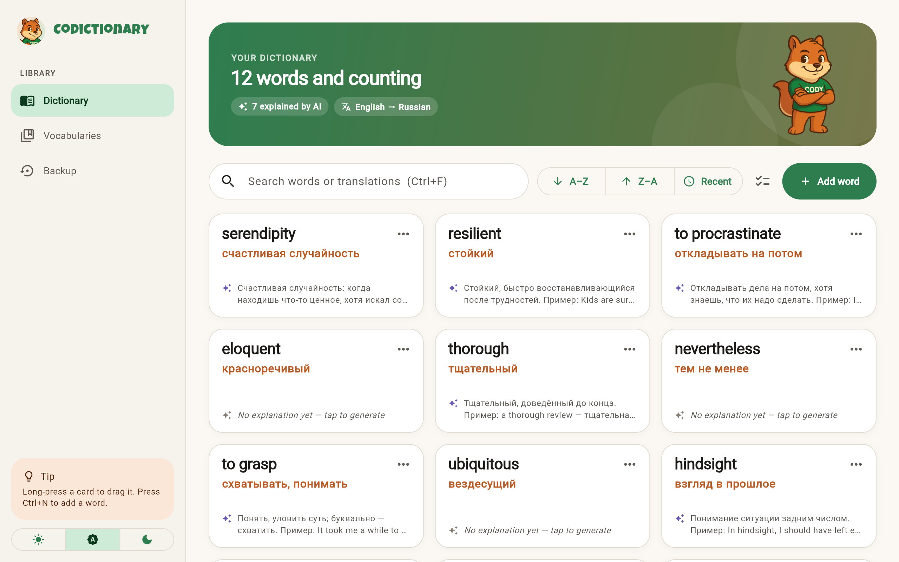
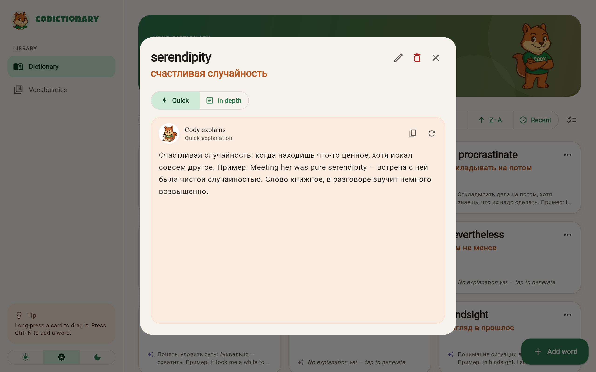
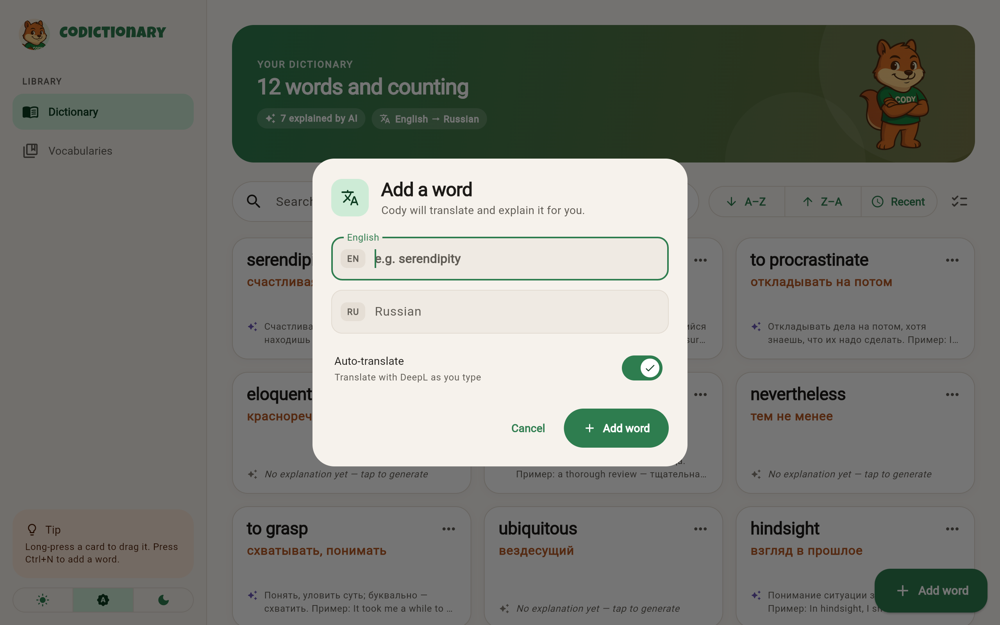
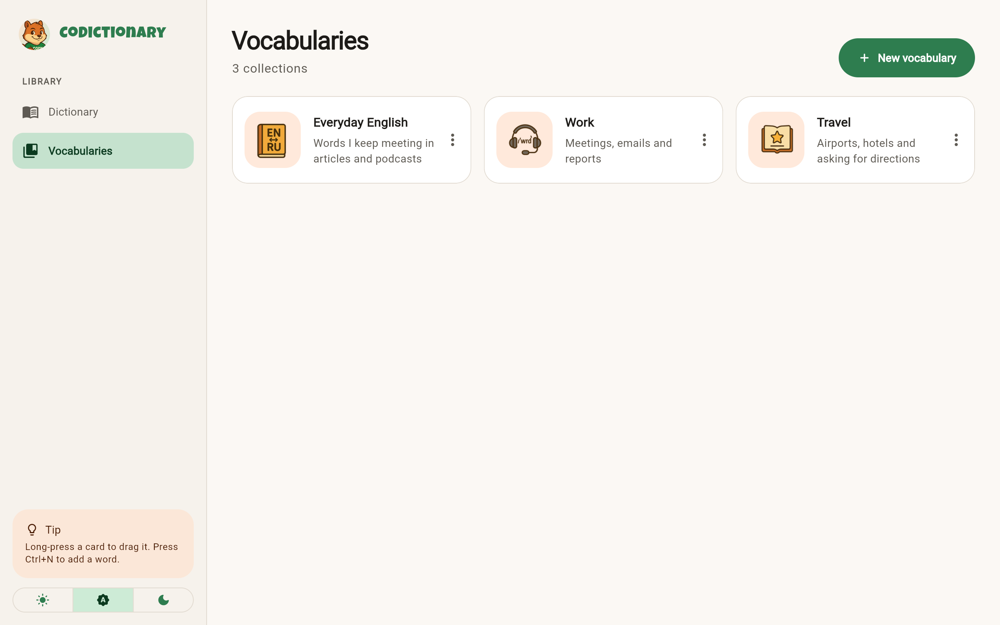
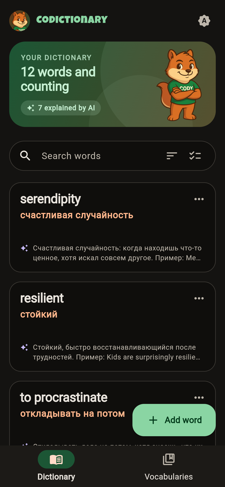

# Codictionary

A personal vocabulary app for learning English words, built with Flutter. Add a
word, let Cody the squirrel fill in the Russian translation, and ask him for a
quick or in-depth explanation with examples when a translation isn't enough.



## Features

- **Word cards** — the English word, its Russian translation and a preview of the
  saved explanation, in a grid that adapts to the screen width.
- **Auto-translate** — type the English word and the Russian field is filled in
  through the DeepL API as you type. Switch it off to enter your own translation.
- **Explanations** — a quick or an in-depth explanation of a word (meaning, usage,
  examples), generated in Russian through the OpenAI API. Copy it, or regenerate it
  if the first answer isn't useful.
- **Search** across both English and Russian. If nothing matches, the search offers
  to add the word you typed.
- **Sorting** A–Z, Z–A or most recent, plus long-press drag-and-drop to reorder by
  hand.
- **Bulk actions** — switch to selection mode, pick several cards and delete them at
  once. Every delete can be undone.
- **Vocabularies** — themed collections with a name, description and icon. Create,
  edit and delete them.
- **Duplicate check** — the same English word can't be added twice.
- **Light and dark themes**, following the system setting by default.
- **Adaptive layout** — a sidebar on screens 900px and wider, a bottom navigation
  bar on phones.
- **Keyboard shortcuts** — `Ctrl+N` adds a word, `Ctrl+F` jumps to search, `Esc`
  leaves selection mode.

| Word details | Adding a word |
| --- | --- |
|  |  |





The screenshots are from the web build with sample data.

## How it stores data

Everything stays on the device — there is no account and no backend.

- Mobile and desktop: a `dictionary.json` file in the app's documents directory.
- Web: the browser's `localStorage`.

## Tech

- Flutter / Dart, Material 3
- Constructor injection from a single composition root (no service locator)
- `http` for the DeepL and OpenAI calls
- `flutter_dotenv` for API keys
- `reorderable_grid_view` for drag-and-drop

The project has Flutter targets for Android, iOS, web, Windows, macOS and Linux.

## Run it locally

You need the [Flutter SDK](https://docs.flutter.dev/get-started/install) (Dart 3.9
or newer).

1. Create a `.env` file in the project root:

   ```
   OPENAI_API_KEY=your-openai-key
   DEEPL_API_KEY=your-deepl-free-key
   ```

   The app won't start if `.env` is missing or empty. Without valid keys the app
   still runs, but auto-translate and explanations return errors.

2. Install dependencies and run:

   ```bash
   flutter pub get
   flutter run
   ```

`.env` is bundled into the app as an asset, so anyone with a build can read the
keys in it. Don't publish a build that contains real keys.

## Tests

```bash
flutter test
```

The tests cover the dictionary view model (load, add, edit, delete, regenerating an
explanation) and the app shell in both wide and narrow layouts.

CI (GitHub Actions) runs the format check, `flutter analyze` and the tests on every
push and pull request.

## Project structure

- `lib/presentation/theme/` — the design system: colour palette taken from Cody,
  light and dark themes, spacing, radius and motion tokens.
- `lib/presentation/shell/` — the adaptive app shell (sidebar or bottom bar).
- `lib/presentation/dictionary/` — the dictionary view, its view model and widgets
  (banner, word card, details sheet, word editor, selection bar).
- `lib/presentation/vocabs/` — the vocabularies view and its dialog.
- `lib/presentation/dialogs/`, `lib/presentation/widgets/` — shared dialogs and
  widgets.
- `lib/domain/` — business logic: `entities`, `repositories` and `services`
  (interfaces), `usecases`, `exceptions`.
- `lib/data/` — implementations: storage (`storage/`), OpenAI and DeepL clients
  (`remote/`), the JSON record (`models/`) and repositories.
- `lib/composition/` — reads `.env` and wires data implementations into the
  domain use cases.

## Architecture

Clean Architecture with MVVM: `presentation → domain ← data`, and only
`lib/composition/` connects the two. The rules are described in
[ARCHITECTURE.MD](ARCHITECTURE.MD) and enforced by `test/architecture_test.dart`.

`main()` reads the config, calls `buildProductionUseCases()` and passes the
result to `CodictionaryApp`, which provides it to the UI through `AppScope`.
ViewModels receive their use cases through the constructor.
